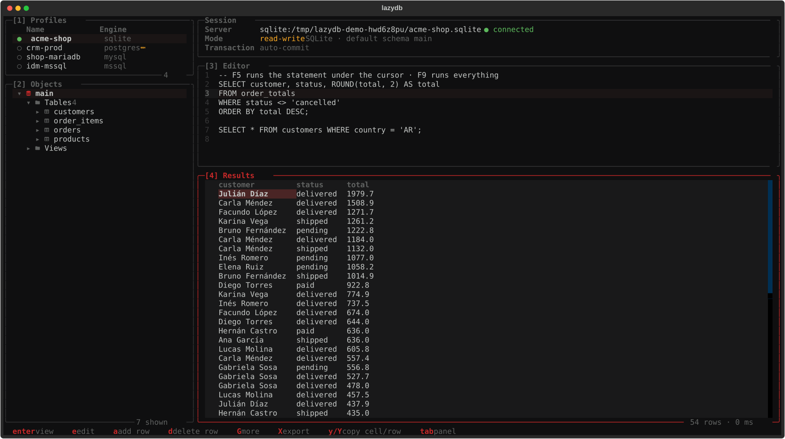
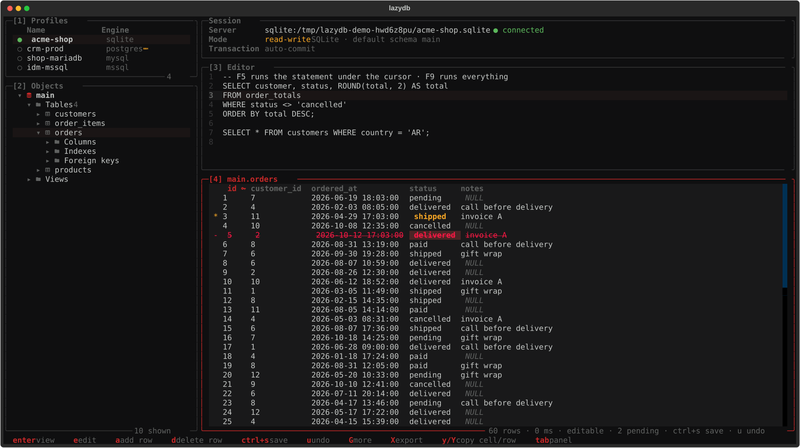
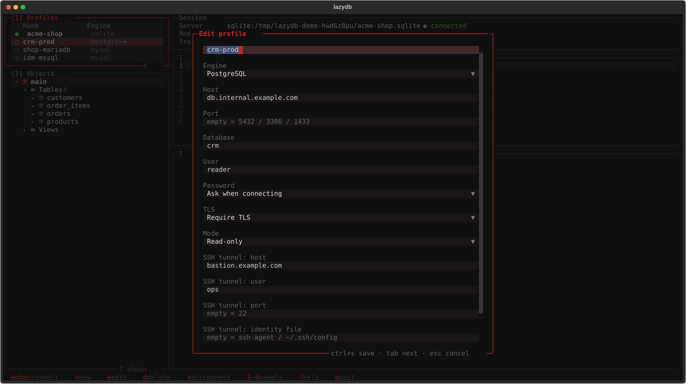

<div align="center">

<h1>lazydb</h1>

**Un cliente de bases de datos para la terminal.**<br>
Perfiles, árbol de objetos, editor SQL, resultados editables y export a Excel o CSV.<br>
PostgreSQL, MySQL / MariaDB, SQL Server y SQLite, directo o por túnel SSH.

<sub>por <a href="https://github.com/D4rkDr4gon">D4rkDr4gon</a> · MIT</sub>

<br><br>



</div>

---

lazydb es un cliente de bases al estilo de **DBeaver**, pero en la terminal y con la forma de
[lazygit](https://github.com/jesseduffield/lazygit): paneles numerados, todo con el teclado y sin salir de la
consola (sirve por SSH). Hecho en Python con [Textual](https://textual.textualize.io/). Es el hermano de
[lazyldap](https://github.com/D4rkDr4gon/lazyldap).

## Qué hace

- **Perfiles de conexión**: motor, host, puerto, base, usuario, **TLS** (requerido, con verificación de
  certificado o deshabilitado) y modo **solo lectura** o lectura-escritura.
- **Túnel SSH integrado**: si la base solo se alcanza desde un bastión, el perfil lleva host, usuario, puerto e
  identidad SSH. lazydb abre un `ssh -L` a un puerto local libre al conectar y lo cierra al desconectar. Usa tu
  `ssh`, así que hereda `~/.ssh/config`, el agente, `known_hosts` y `ProxyJump`.
- **Login seguro**: la contraseña se pide al conectar o queda en el **keyring** del sistema (libsecret). Nunca se
  escribe en disco.
- **Árbol de objetos** que se carga por niveles: esquemas → tablas, vistas y rutinas → columnas (con tipo, PK,
  NOT NULL y default), índices y claves foráneas. Filtro por nombre, conteo de filas y **DDL** de tablas, vistas
  y funciones.
- **Editor SQL** con historial por perfil: `F5` corre la sentencia del cursor (o la selección) y `F9` todo el
  texto. Entiende `;`, comentarios, `$$...$$` de Postgres y los `GO` de SQL Server. El texto del editor se
  recuerda entre sesiones.
- **Resultados** por tandas (de a 500 filas, `G` trae más), con los `NULL` y los binarios marcados.
- **Edición de datos** sobre una tabla con clave primaria: editar celdas, agregar y borrar filas. Los cambios
  quedan **pendientes** (marcados en la grilla) hasta `ctrl+s`, que muestra el SQL y lo aplica **todo junto en una
  transacción**: si algo falla, no se guarda nada.
- **Transacciones a mano**: lo que el editor modifica (`UPDATE`, `DELETE`, DDL...) queda en una transacción
  abierta hasta que hagas commit (`C`) o rollback (`R`). La transacción abierta se ve en el panel de sesión.
- **Solo lectura de verdad**: en un perfil read-only solo corren `SELECT`, `WITH`, `SHOW` y `EXPLAIN`. Además, la
  sesión se abre como solo lectura donde el motor lo permite (Postgres y MySQL por sesión, SQLite con `mode=ro`).
- **Export a Excel** (`.xlsx`) **o CSV** de los resultados: las filas cargadas o la consulta completa.
- **Log de la sesión**: conexión, túnel, cada consulta con filas y duración, cada escritura, commit y rollback.
- **Modo demo** con una base SQLite de ejemplo (una tienda) para probarlo sin servidor.

## Probalo sin servidor

```sh
lazydb --demo
```

Abre una base SQLite de ejemplo con clientes, productos, pedidos y vistas, en modo read-write. No toca tus perfiles
ni tu configuración. También podés abrir cualquier archivo SQLite directo:

```sh
lazydb ~/proyectos/app/data.sqlite
```

## Instalación

Requiere Python 3.10+ y una terminal con una [Nerd Font](https://www.nerdfonts.com/) (para los íconos). Los drivers
de cada motor son opcionales: instalá los que uses.

```sh
# con pipx (recomendado): todos los motores y resaltado de SQL
pipx install "lazydb[all] @ git+https://github.com/D4rkDr4gon/lazydb"

# o solo lo que necesites: postgres, mysql, mssql, syntax
pipx install "lazydb[postgres,mysql] @ git+https://github.com/D4rkDr4gon/lazydb"
```

En **Arch Linux** casi todo está en los repos oficiales, así que se puede correr directo desde el clon:

```sh
sudo pacman -S python-textual python-psycopg python-pymysql   # pymssql: pip o BlackArch
git clone https://github.com/D4rkDr4gon/lazydb
cd lazydb && PYTHONPATH=src python -m lazydb
```

| Motor | Driver | Notas |
|---|---|---|
| PostgreSQL | `psycopg` 3 | |
| MySQL / MariaDB | `pymysql` | cada base es un esquema del árbol |
| SQL Server | `pymssql` | SQL Server 2017+ (índices y FKs usan `STRING_AGG`) |
| SQLite | `sqlite3` (stdlib) | la "base" del perfil es la ruta del archivo |

Opcionales: `secret-tool` (paquete `libsecret`) para guardar contraseñas en el keyring, `wl-copy` / `xclip` para
copiar al portapapeles y `textual[syntax]` para el resaltado de SQL.

## Uso

```sh
lazydb              # abre en la lista de perfiles
lazydb crm-prod     # conecta a ese perfil al arrancar
lazydb data.sqlite  # abre un archivo SQLite
lazydb --demo       # base de ejemplo
```

1. `n` en **Profiles** para crear un perfil.
2. `enter` para conectar: pide la contraseña (o la toma del keyring).
3. Recorré el árbol con `j`/`k` y `l` / `h`; `enter` sobre una tabla la abre en **Results**.
4. `3` para ir al editor, `F5` para correr la sentencia, `esc` para volver a los resultados.

### Atajos

| Tecla | Profiles | Objects | Results |
|---|---|---|---|
| `enter` | conectar | abrir tabla / expandir | ver el valor completo |
| `l` `→` / `h` `←` | | expandir / colapsar o subir | columna siguiente / anterior |
| `n` | nuevo perfil | | |
| `e` | editar perfil | | editar celda |
| `a` | | | agregar fila |
| `d` | borrar perfil | | marcar / desmarcar fila para borrar |
| `ctrl+s` | | | guardar los cambios pendientes |
| `u` | | | descartar los cambios pendientes |
| `s` | | `SELECT` al editor | |
| `D` | | DDL | |
| `c` | | contar filas | |
| `/` | | filtrar por nombre | |
| `G` | | | traer más filas |
| `X` | | | exportar (Excel o CSV) |
| `y` / `Y` | | copiar nombre | copiar celda / fila |
| `ctrl+y` | | | copiar toda la grilla como tabla de texto alineada |
| `r` | releer perfiles | refrescar | volver a correr |
| `x` | desconectar | desconectar | desconectar |

En cualquier panel: `F5` / `ctrl+r` corre la sentencia del editor, `F9` corre todo, `C` hace commit, `R` hace
rollback, `H` abre el historial, `L` el log de la sesión, `1` `2` `3` `4` o `tab` cambian de panel, `?` muestra la
ayuda y `q` sale (pregunta si hay cambios sin guardar o una transacción abierta). En el editor las letras son
texto: usá `F5` / `F9`, `esc` para salir y `tab` para cambiar de panel.

## Editar datos



Se puede editar cuando los resultados vienen de **una sola tabla con clave primaria**: abierta desde el árbol, o un
`SELECT` de columnas tal cual de una tabla (`SELECT id, email FROM customers WHERE ...`). Si la consulta tiene
joins, agregados o expresiones, los resultados son de solo lectura, como en DBeaver.

- `e` edita la celda. Escribí `\N` para guardar `NULL`.
- `a` agrega una fila: pide cada columna con su tipo y te avisa cuáles son obligatorias. Las que dejás vacías
  toman el default de la tabla.
- `d` marca la fila para borrar (y la desmarca).

Los cambios se ven en la grilla (`*` editada, `-` borrada, `+` nueva) y no tocan la base hasta `ctrl+s`. Antes de
aplicarlos se muestra el SQL. Todo corre en una transacción, y cada fila se identifica por los valores originales
de su clave primaria; si un `UPDATE` o `DELETE` no toca exactamente una fila, se deshace todo. Si algo falla (una
FK, un `UNIQUE`), no se guarda nada y los cambios quedan pendientes para corregirlos.

## Perfiles, contraseñas y túnel SSH



Los perfiles se guardan en `~/.config/lazydb/profiles.json` (permisos `600`) y **nunca** llevan contraseñas. Con
**Store in keyring**, la contraseña se pide la primera vez y queda en libsecret (`secret-tool`, atributos
`app=lazydb profile=<nombre>`). Con **No password**, no se pide ninguna (por ejemplo, Postgres con `peer` o
`trust`).

Con **SSH tunnel: host** completado, lazydb corre:

```sh
ssh -N -L 127.0.0.1:<puerto libre>:<host de la base>:<puerto> [-p puerto] [-i identidad] [usuario@]bastión
```

con `BatchMode=yes`: no pide contraseñas, así que usá una clave o el agente. El host de la base se resuelve **desde
el bastión** (puede ser un nombre interno o `localhost` si la base corre en el mismo bastión). Si ssh falla, su
error aparece al conectar; el túnel se cierra al desconectar o al salir.

El historial de consultas y el texto del editor de cada perfil van a `~/.local/state/lazydb/state.json`
(permisos `600`).

## Personalizar

- **Colores**: `~/.config/lazydb/theme.json` (o `LAZYDB_THEME`) con `primary`, `secondary`, `background`,
  `foreground` y los `status_*`. Por defecto, rojo sobre negro.
- **Teclas**: `~/.config/lazydb/keymap.json` (o `LAZYDB_KEYMAP`), por ejemplo
  `{"LazyDbView.run_statement": "ctrl+e"}`. Con `?` ves el id de cada acción.

## Desarrollo

```sh
PYTHONPATH=src python -m unittest discover -s tests
```

Los tests corren contra la base SQLite del modo demo, la TUI incluida (headless, con `App.run_test`).

## Licencia

MIT
